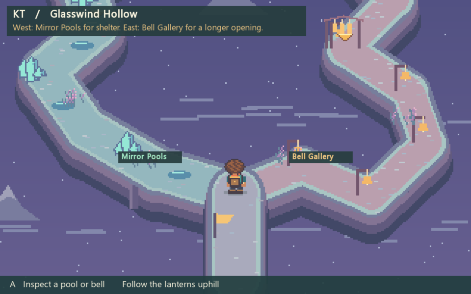

# KT

**Version 1.0.0 for Windows x64.** KT is an offline pixel-art climbing game. Walk out of Willow Bay, repair the bridge, learn two mountain guardians' attacks, and carry the summit flag to altitude 90. The upper trails generate encounters from your local progress.



## Play

Download [KT.exe for Windows x64](https://github.com/creativekamrul/kt/releases/latest/download/KT.exe) and double-click it. The game starts full-screen. **F11** switches to a window. Art, music and level data are embedded in the executable. KT prepares its assets and stores your progress under `%LOCALAPPDATA%\KT`. To continue an older portable save, close the game and place its `sdp100.db` beside the new executable.

| Action | Keyboard | Xbox-layout controller |
|---|---|---|
| Walk or choose a menu item | WASD or arrows to walk, arrows in menus | Left stick or D-pad |
| Talk, inspect, strike, raise the flag | E | A |
| Dodge on the mountain | Space | B |
| Parry on the mountain | Q | X |
| Journal outside combat | J | Y |
| Pause | Esc | Start |

At Willow Bridge you can drag a plank, click it and then its gap, or use the controller to select both.

## The climb

- **Willow Bay.** Follow gold arrows to the bridge. Nia's creek bells, Sol's pennant and Kit's wind-moth practice are optional stops.
- **Bracken Rise.** Fern Switchback gives an extra heart. Cairn Steps makes a successful parry last longer. Learn the copperhorn's charge and ground ripple.
- **Glasswind Hollow.** Inspect a mirror pool for a ward or ring a gallery bell for a longer opening. Reflect the moonkite's gold feather, dodge its falling shadows, and counter when it lands.
- **Upper mountain.** Cross creeks, carry supplies, rig ropes and choose routes. Generated encounters adapt as you climb. Expeditions unlock at altitudes 10, 30 and 60. At 90, walk the last ridge, raise the flag and return home.

Guardian victories, completed encounters, bridge repairs and errands save locally. The north pass in Willow Bay takes you back to the latest unlocked region. An unfinished fight restarts at full health.

## Build from source

On 64-bit Windows, install Python 3.13 x64 and Git and make both available on PATH. From the project root run the following in PowerShell.

```powershell
.\setup.cmd -Quick
.\kt.cmd play
.\kt.cmd test
.\kt.cmd package
```

Setup installs project-local tools and fetches the pinned SFML 2.6.2 and FreeType 2.13.3 source commits. The build uses C++17, Zig 0.13.0, CMake and Ninja. The separate offline laptop kit includes its own Python, wheels and dependency source. Running `setup.cmd` without `-Quick` also reproduces the simulation baselines and charts.

Packaging creates the standalone `KT.exe`, an optional Windows ZIP, a clean source ZIP and SHA-256 checksums under `out/`. The GitHub Actions workflow runs the Windows build and tests and uploads those files as workflow artifacts. Players need only `KT.exe`.

## Project layout

| Directory | Contents |
|---|---|
| `shell/` | SFML game, mountain encounters, pixel art and music |
| `core/` | Graphics-independent generator, adaptive controller, campaign rules and storage |
| `content/` | Curriculum, quiz banks and player-facing strings |
| `tests/` | Core regression tests and Glasswind traversal and combat tests |
| `tools/` | Build, verification, release packaging and original sprite sources |
| `docs/` | Engine architecture, simulation methods and course design history |

The MIT license covers the project. Dependency notices are in [THIRD_PARTY.md](THIRD_PARTY.md). See the [architecture](docs/architecture.md) and [adaptive engine notes](docs/adaptive-engine.md) for the course project.

## Evidence at a glance

300 simulated children x 300 answers x 5 difficulty policies
(seed 20260925, 90,000 answers per policy), success rate in the last third:

| Policy | Weak children | Mid | Strong | Mean distance from 0.75 |
|---|---|---|---|---|
| **latent Thompson (shipped)** | **0.748** | **0.777** | **0.806** | **0.043** |
| independent Beta arms | 0.609 | 0.776 | 0.902 | 0.117 |
| UCB1 (shaped reward) | 0.477 | 0.651 | 0.822 | 0.152 |
| greedy, no exploration | 0.769 | 0.871 | 0.927 | 0.115 |
| static difficulty (baseline) | 0.404 | 0.720 | 0.913 | 0.207 |

The shipped policy brings simulated group averages near the 70-80% target band;
the strongest group's 80.6% is slightly above it. Fixed difficulty produces about
40% success for the weakest group and 91% for the strongest. These simulations
measure answer success, not frustration, boredom or learning outcomes.


Robustness: when the simulated child is given a deliberately different response curve
(steeper, lower guessing floor), the shipped policy barely moves (mean deviation 0.046
vs 0.043) while static difficulty degrades from 0.207 to 0.266.
