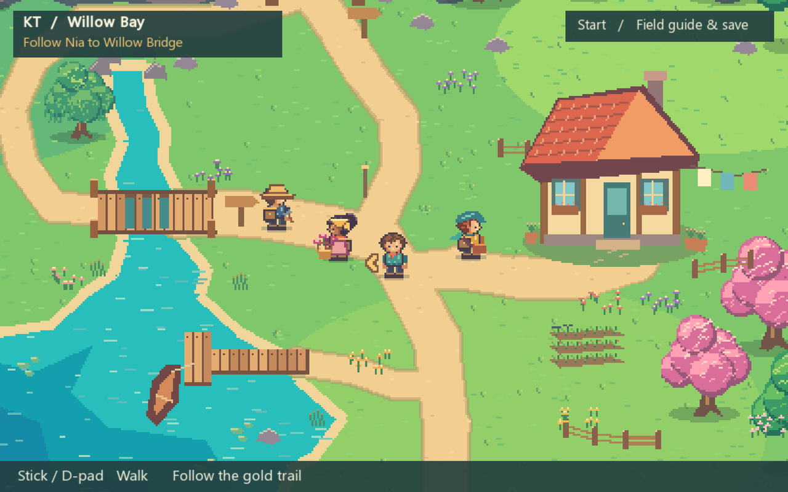
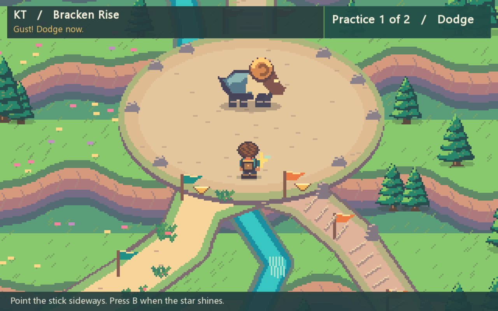
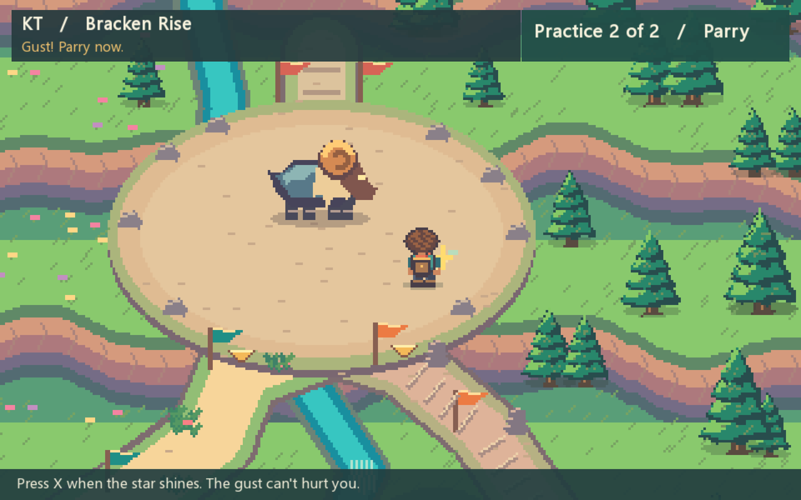
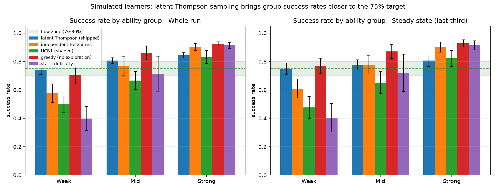

# KT

KT is an offline pixel-art mountain adventure for Windows. Your first landmark is a broken footbridge west of Willow Bay. Repair it, pick a path through the foothills, and learn when to dodge, parry, or strike. Beyond the guardians, every solved trail encounter takes you closer to the summit flag at altitude 90.

**[Install KT for Windows x64](https://github.com/creativekamrul/kt/releases/latest/download/KT-Setup.exe)** · [Portable KT.exe](https://github.com/creativekamrul/kt/releases/latest/download/KT.exe) · [Player guide and boss screenshots](docs/player-guide.md) · [Build from source](#build-from-source)

## What's new in KT 1.2.2

Choose **New climber** to try the opening. Talk to Nia in Willow Bay plaza with **E** or controller **A**, then choose **Walk with Nia**. She walks ahead toward the bridge and waits if you fall behind. At the creek, her counting hint helps you fit the first plank. Finish all three spans and Sol taps the last plank into place for Nia's first crossing.



| Dodge the practice gust | Parry the next gust |
|---|---|
|  |  |
| Face sideways and press **Space / B** when the star shines. | Press **Q / X** on the next star. Practice costs no hearts, and you choose when to continue. |

Open the trail journal outside combat with **J / Y**. Each guardian adds a stamp when you first meet. Show Sol what you've seen, then visit the cleared guardians to say hello.


Lost on the trail? Open the field guide with **F1**, or **Start > Field guide** on a controller. Choose **Show me the way** for ten seconds of gold trail markers. The illustrated guide covers the bridge puzzle, all four boss fights, expeditions, camp saves and the parent report. [Read the player guide](docs/player-guide.md) · [KT 1.2.2 release notes](https://github.com/creativekamrul/kt/releases/tag/v1.2.2).

## Play on Windows

Run **KT-Setup.exe**, then open **KT** from Start. During setup you can also select **Create a Play KT shortcut on my desktop**. To uninstall, open **Settings > Apps > Installed apps > KT**. Your saved climbers stay on this Windows account.

If you prefer the portable download, double-click **KT.exe**. Art, music and level data are bundled inside. KT starts full-screen. Press **F11** to switch to a window. Saves live in `%LOCALAPPDATA%\KT`. For an older portable save, close KT and place its `sdp100.db` beside the executable.

| Action | Keyboard | Xbox-layout controller |
|---|---|---|
| Walk or navigate menus | WASD or arrow keys to walk, arrows in menus | Left stick or D-pad |
| Talk, inspect, strike, raise the flag | E | A |
| Dodge / parry in combat | Space / Q | B / X |
| Open the journal outside combat | J | Y |
| Pause | Esc | Start |
| Read the field guide | F1 | Start, then Field guide |

## How the mountain adapts

Willow Bay, the bridge and the guardian arenas have fixed layouts, so landmarks and attack cues stay familiar. On the upper mountain, the adaptive controller uses saved answers to select the next skill and difficulty. The level generator then creates a seeded encounter. For example, a supply task turns a numerical answer into a bundle you must find and carry back to camp.

The difficulty policy uses Thompson sampling. It samples a plausible ability from its current estimate, then picks a difficulty with a predicted chance of success near 75%. The next answer updates the estimate. A wrong answer leaves your altitude intact. The simulation results below show how this behaves with modeled players. [Adaptive engine notes](docs/adaptive-engine.md) · [Architecture](docs/architecture.md).

## Build from source

On 64-bit Windows, install Python 3.13 x64 and Git and make both available on PATH. From the project root run the following in PowerShell.

```powershell
.\setup.cmd -Quick
.\kt.cmd play
.\kt.cmd test
.\kt.cmd package
```

Setup installs project-local tools and fetches the pinned SFML 2.6.2 and FreeType 2.13.3 source commits. The build uses C++17, Zig 0.13.0, CMake and Ninja. The separate offline laptop kit includes its own Python, wheels and dependency source. Running `setup.cmd` without `-Quick` also reproduces the simulation baselines and charts.

Packaging creates the standalone `KT.exe`, an optional Windows ZIP, a clean source ZIP and SHA-256 checksums under `out/`. The GitHub Actions workflow runs the Windows build and tests and uploads those files as workflow artifacts. To build the installer locally, install Inno Setup 6 and run `.\tools\build-installer.ps1` after packaging.

## Project layout

| Directory | Contents |
|---|---|
| `shell/` | SFML game, mountain encounters, pixel art and music |
| `core/` | Graphics-independent generator, adaptive controller, campaign rules and storage |
| `content/` | Curriculum, quiz banks and player-facing strings |
| `tests/` | Core regression tests and Glasswind traversal and combat tests |
| `tools/` | Build, verification, release packaging and original sprite sources |
| `docs/` | Engine architecture, simulation methods and course design history |

The MIT license covers the project. Dependency notices are in [THIRD_PARTY.md](THIRD_PARTY.md). See the [architecture](docs/architecture.md) and [adaptive engine notes](docs/adaptive-engine.md) for the course project.

## Evidence at a glance

300 simulated children x 300 answers x 5 difficulty policies
(seed 20260925, 90,000 answers per policy), success rate in the last third:

| Policy | Weak children | Mid | Strong | Mean distance from 0.75 |
|---|---|---|---|---|
| **latent Thompson (shipped)** | **0.748** | **0.777** | **0.806** | **0.043** |
| independent Beta arms | 0.609 | 0.776 | 0.902 | 0.117 |
| UCB1 (shaped reward) | 0.477 | 0.651 | 0.822 | 0.152 |
| greedy, no exploration | 0.769 | 0.871 | 0.927 | 0.115 |
| static difficulty (baseline) | 0.404 | 0.720 | 0.913 | 0.207 |

The shipped policy brings simulated group averages near the 70-80% target band;
the strongest group's 80.6% is slightly above it. Fixed difficulty produces about
40% success for the weakest group and 91% for the strongest. These simulations
measure answer success, not frustration, boredom or learning outcomes.



Robustness: when the simulated child is given a deliberately different response curve
(steeper, lower guessing floor), the shipped policy barely moves (mean deviation 0.046
vs 0.043) while static difficulty degrades from 0.207 to 0.266.
