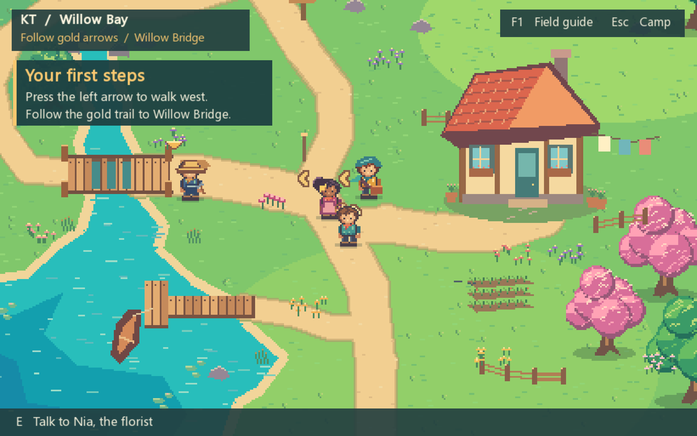
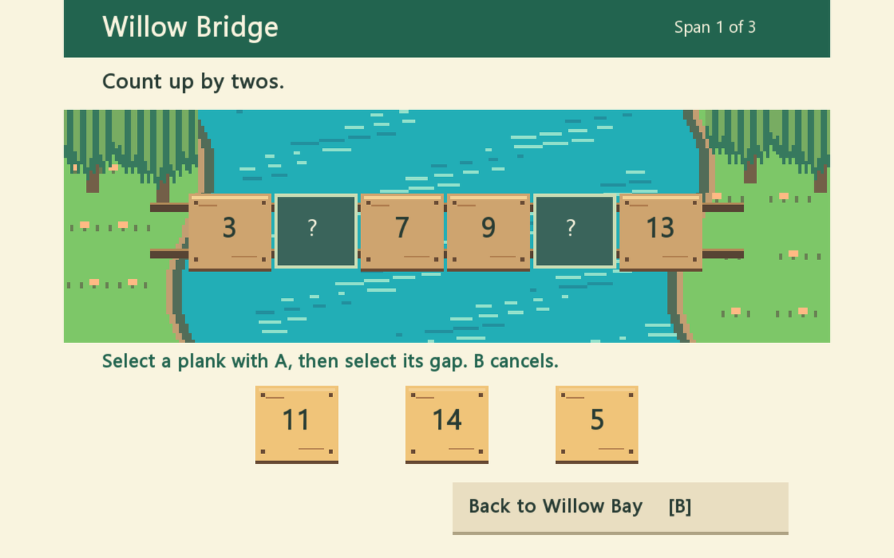
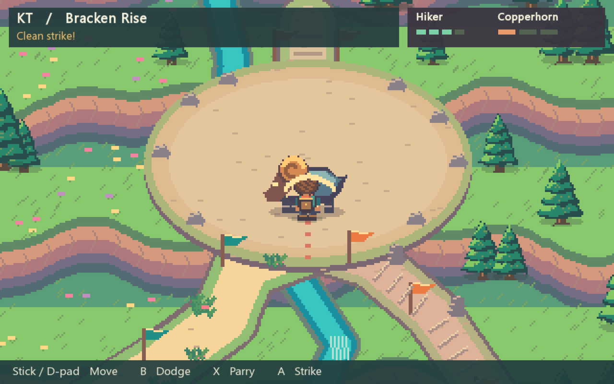
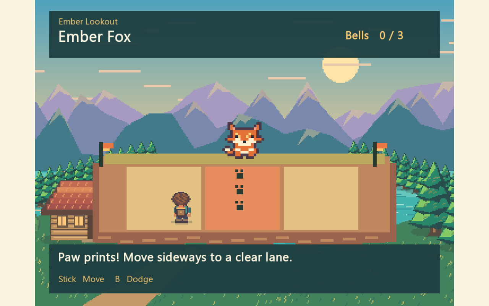
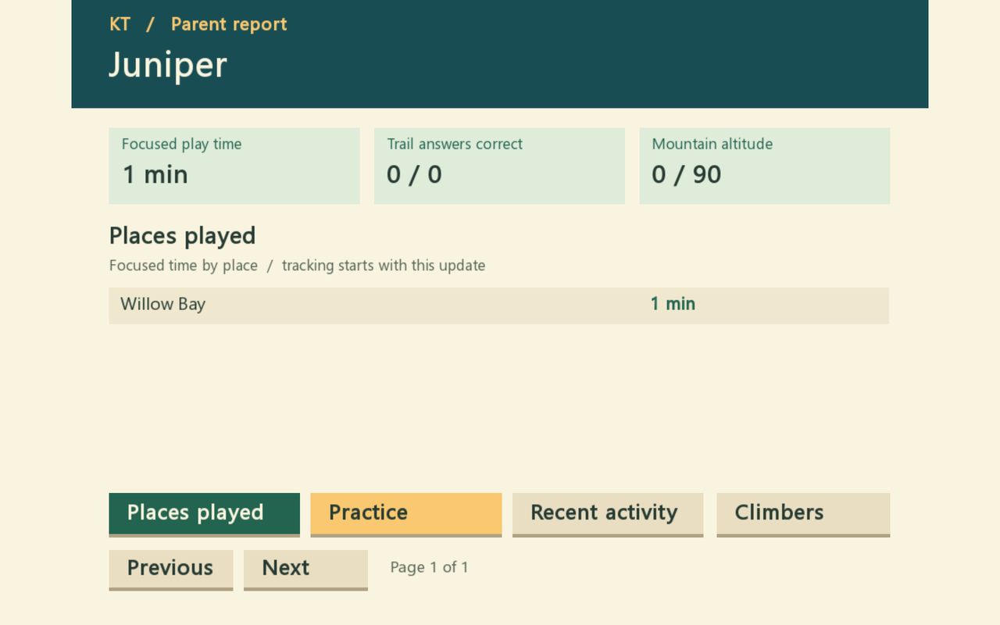

# KT player guide

Follow one climber from the village to the summit. The screenshots below were captured during a playthrough of version 1.2. The bridge, lower guardians, expeditions and summit are also playable in the [Windows 1.0 release](https://github.com/creativekamrul/kt/releases/tag/v1.0.0).

## From the village to the bridge

Start in Willow Bay plaza and walk west along the gold arrows. When you reach a person or sign, press **E** on a keyboard or **A** on an Xbox-layout controller. The villagers have optional stops along the way. Nia sends you to pick creek bells, Sol has a trail pennant to raise, and Kit lets you practice against a wind moth.

At Willow Bridge, read the instruction above the deck before picking a plank. In the span below, the numbers go **3, 5, 7, 9, 11, 13**. The gaps take **5** and **11**, and one spare plank stays on the bank. Later spans change the rule. Once you complete all three, walk across the repaired bridge and follow the pennants into Bracken Rise.

## Meet the guardians

### Copperhorn on Bracken Rise

The fork gives you a choice before the fight. The teal **Fern Switchback** grants an extra heart. The orange **Cairn Steps** give you more time to strike after a parry. In the clearing, watch where the horns point. When the charge line appears, dodge sideways or parry as the ram reaches you. A raised hoof signals a ripple. When the Copperhorn rests or staggers, move close and strike.

### Moonkite in Glasswind Hollow

Inspect the **Mirror Pools** for a ward that absorbs one hit, or ring the **Bell Gallery** bell for a longer opening. At the roost, spread wings signal a feather volley. The central gold feather can be parried. Move out of the falling shadows, then close the distance and strike when the Moonkite lands.

### Two more guardians in version 1.2

| Ember Fox at altitude 12 | Bellback Tortoise at altitude 36 |
|---|---|
|  |  |
| Wait for the paw prints. Move sideways into a clear lane. After the fox passes, press **E / A** to ring your bell. | Let the small notes pass. When the big star appears, press **Q / X** to parry. The star makes the timing visible even with sound off. |

Both wait until you say you're ready. Ring three bells to pass. Missing a cue lets you try again with the bells already earned in that fight.

## Puzzles you play on the trail

Read the goal at the top of the screen, then walk to the objects it describes. A route choice asks you to inspect a marker. A supply task asks you to pick up the matching bundle and bring it back to the crate. A safety line asks you to visit anchors in the displayed order. When the rope opens, walk uphill to climb. Wrong answers leave your altitude intact.

The journal tracks four three-stage expeditions. Each has its own achievement.

| Expedition | Opens at altitude | What you do | Achievement |
|---|---:|---|---|
| Willow Bridge | 0 | Fill missing planks while counting forward, backward and by threes. | Bridge Builder |
| Pack the Lookout | 10 | Pack grouped supplies, share biscuits and work out how many cups are missing. | Quartermaster |
| Cairn Pass | 30 | Compare neighboring cairns and find the next number in the trail. | Pathfinder |
| Snowline Beacon | 60 | Count flashes, find working cells and predict the next signal. | Beacon Keeper |

At altitude **90**, walk up and right along the snowy ridge. Press **E / A** beside the pole to raise the summit flag, then return to Willow Bay.

## Saves and the parent report

KT saves progress locally on the Windows account. Guardian victories, finished expedition stages and village errands persist between visits. The north pass in Willow Bay takes you back toward your unlocked mountain areas.

In **version 1.2**, pick a nickname at the lodge. Each climber has a separate save. Entering an area sets a camp automatically, and **Pause > Save game** saves the current camp manually. Select **Continue** beneath the nickname to return. The upper trail resumes at the saved altitude. An unfinished guardian battle starts fresh.

Choose the climber and open **Parent report** to see focused play time by place, correct answers and attempts by skill, and dated activity such as a delivered errand or cleared guardian. Menus and time with the game in the background are excluded. Time tracking starts with version 1.1. The report below uses a demonstration profile.

[Back to the KT README](../README.md)
