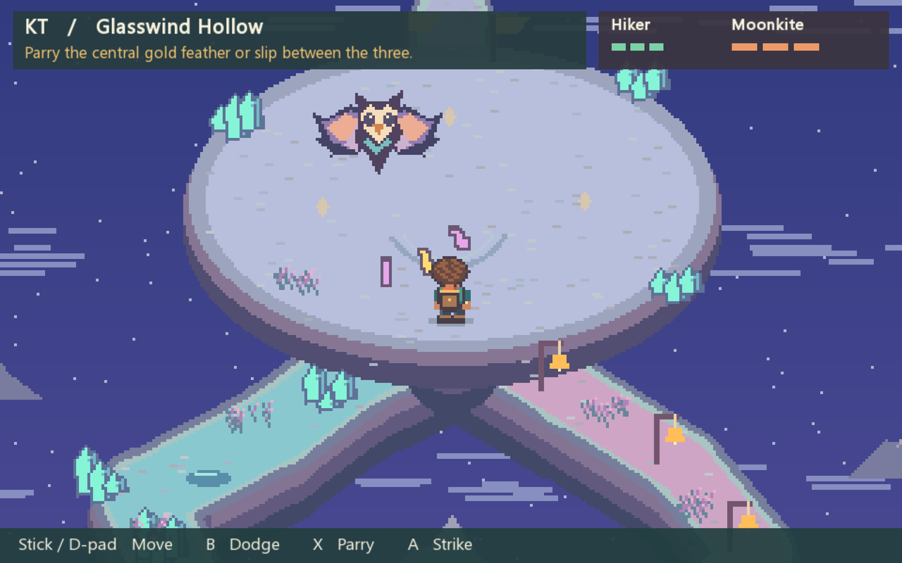
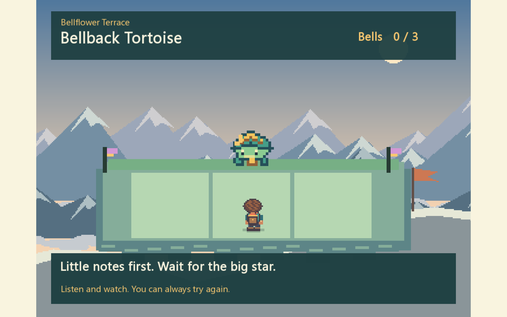
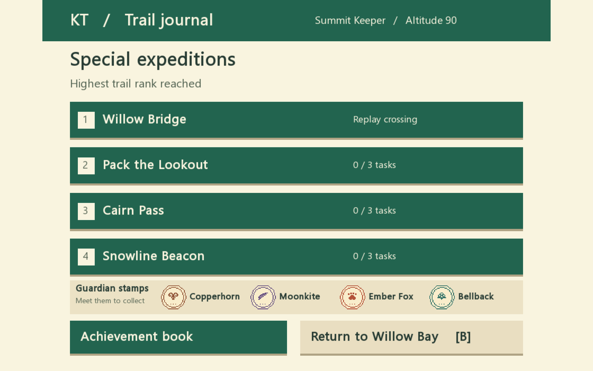
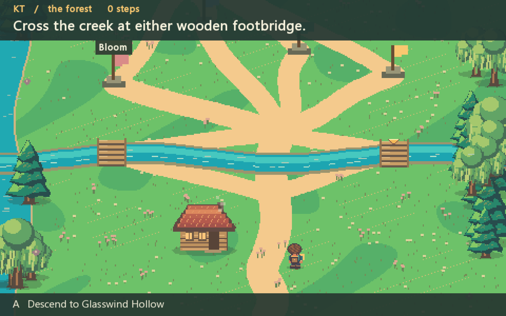

# KT 1.2.2 player guide

Start with **New climber** for the guided opening, or choose **Continue** beneath an existing nickname to return to camp. Keyboard and Xbox-layout controller buttons appear together below, with the keyboard first. [Download KT 1.2.2 for Windows](https://github.com/creativekamrul/kt/releases/tag/v1.2.2).

## Walk with Nia to Willow Bridge

Find Nia by the gold marker in Willow Bay plaza. Press **E / A** to talk, then confirm **Walk with Nia**. Follow her west with the arrow keys, WASD, left stick or D-pad. If you stop to look around, she waits. You can also walk to the bridge yourself. Later, Nia has creek bells to deliver, Sol has a pennant to raise, and Kit offers wind-moth practice.

While exploring, open the field guide with **F1** or **Start > Field guide**, then choose **Show me the way**. Follow the brighter gold markers for ten seconds and ask again whenever you like.

At Willow Bridge, read the instruction above the deck before picking a plank. In the span below, the numbers go **3, 5, 7, 9, 11, 13**. The gaps take **5** and **11**, and one spare plank stays on the bank. Nia counts along in the on-screen hint for the first gap. Click a plank and then its gap, drag it, or select both with **A**. The numbers can differ between climbers. Later spans change the rule. Complete all three to earn **Bridge Builder**. Watch Sol tap the last plank into place and Nia cross, then follow the pennants to Bracken Rise.

## Practice before the Copperhorn

At the clearing, a harmless gust teaches two moves. Watch for the bright star beside your climber.

1. **Dodge.** Face sideways and press **Space / B** as the star shines. If you're early, wait for the gust to come around again.
2. **Parry.** Let the next gust approach. Press **Q / X** when the star shines to catch it.

| First cue | Second cue |
|---|---|
|  |  |

Missed cues cost no hearts. Once both moves are learned, press **E / A** to finish practice and head into the clearing. KT remembers the lesson for this climber.

## Meet the guardians

### Copperhorn on Bracken Rise

The fork gives you a choice before the fight. The teal **Fern Switchback** grants an extra heart. The orange **Cairn Steps** give you more time to strike after a parry. In the clearing, watch where the horns point. Two low hoofbeats accompany the wind-up. When the charge line appears, dodge sideways or parry as the ram reaches you. A raised hoof signals a ripple. When the Copperhorn rests or staggers, move close and strike.

### Moonkite in Glasswind Hollow

Inspect the **Mirror Pools** for a ward that absorbs one hit, or ring the **Bell Gallery** bell for a longer opening. At the roost, a rising whistle and spread wings signal a feather volley. The central gold feather can be parried. Move out of the falling shadows, then close the distance and strike when the Moonkite lands.

### The upper mountain guardians

| Ember Fox at altitude 12 | Bellback Tortoise at altitude 36 |
|---|---|
|  |  |
| Watch for paw prints and listen for three quick footfalls. Move sideways into a clear lane. After the fox passes, press **E / A** to ring your bell. | Let the small notes pass. When the bell rings and the big star appears, press **Q / X** to parry. The star makes the timing visible even with sound off. |

Both wait until you say you're ready. Ring three bells to pass. Missing a cue lets you try again with the bells already earned in that fight.

## Guardian stamps and homecomings

Open the journal with **J / Y** outside combat. A question mark becomes a stamp the first time that climber meets the guardian, even before winning the fight. All four stamps are visible in this completed journal.

Back in Willow Bay, talk to Sol to hear what he remembers about your encounters. After their fights, approach the Copperhorn in its clearing or the Moonkite at its roost and press **E / A** to say hello. The Ember Fox and Bellback visit Willow Bay plaza after you clear their passes.

## Puzzles you play on the trail

Read the goal at the top of the screen, then walk to the objects it describes. A route choice asks you to inspect a marker. A supply task asks you to pick up the matching bundle and bring it back to the crate. A safety line asks you to visit anchors in the displayed order. When the rope opens, walk uphill to climb. Wrong answers leave your altitude intact.

The journal tracks four three-stage expeditions. Each has its own achievement.

| Expedition | Opens at altitude | What you do | Achievement |
|---|---:|---|---|
| Willow Bridge | 0 | Fill missing planks while counting forward, backward and by threes. | Bridge Builder |
| Pack the Lookout | 10 | Pack grouped supplies, share biscuits and work out how many cups are missing. | Quartermaster |
| Cairn Pass | 30 | Compare neighboring cairns and find the next number in the trail. | Pathfinder |
| Snowline Beacon | 60 | Count flashes, find working cells and predict the next signal. | Beacon Keeper |

At altitude **90**, walk up and right along the snowy ridge. Press **E / A** beside the pole to raise the summit flag, then return to Willow Bay.

## Saves and the parent report

KT saves progress locally on the Windows account. Guardian victories, finished expedition stages and village errands persist between visits. The north pass in Willow Bay takes you back toward your unlocked mountain areas.

Pick a nickname at the lodge. Each climber has a separate save. Entering an area sets a camp automatically, and **Pause > Save game** saves the current camp manually. Select **Continue** beneath the nickname to return. The upper trail resumes at the saved altitude. An unfinished guardian battle starts fresh.

Choose the climber and open **Parent report** to see focused play time by place, correct answers and attempts by skill, and dated activity such as a delivered errand or cleared guardian. Menus and time with the game in the background are excluded. Time tracking starts with version 1.1. The report below uses a demonstration profile.

[Back to the KT README](../README.md)
